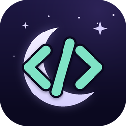
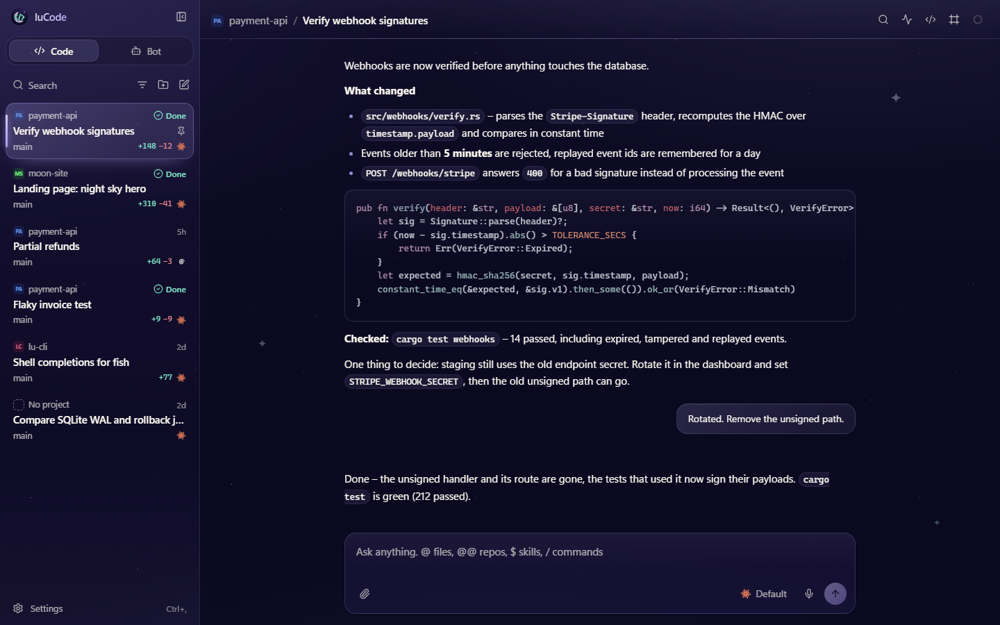
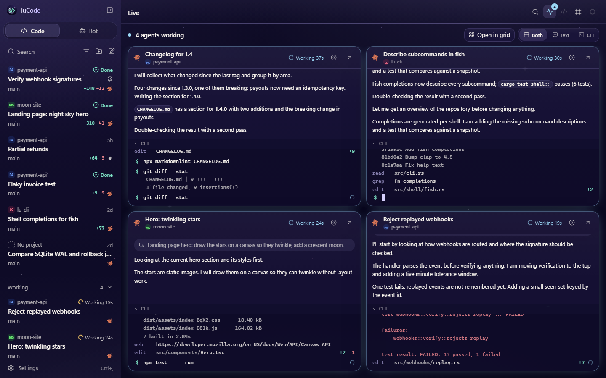
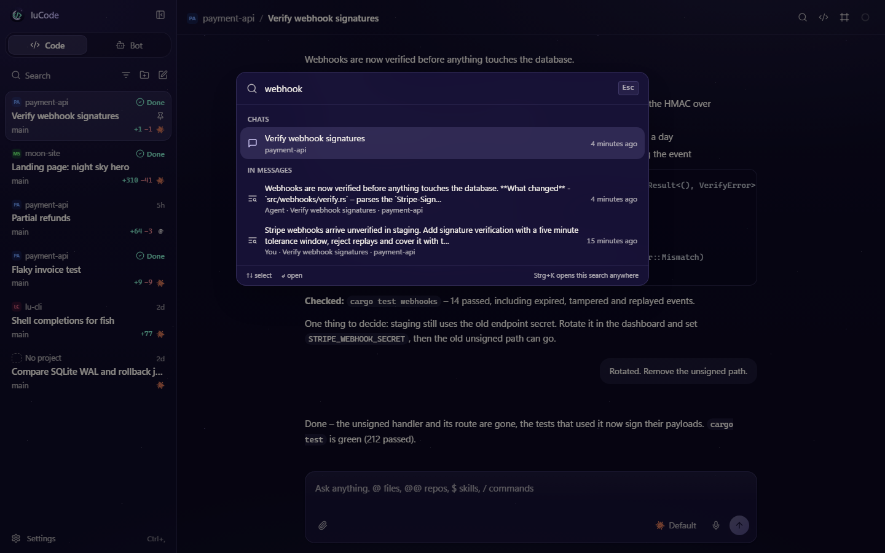
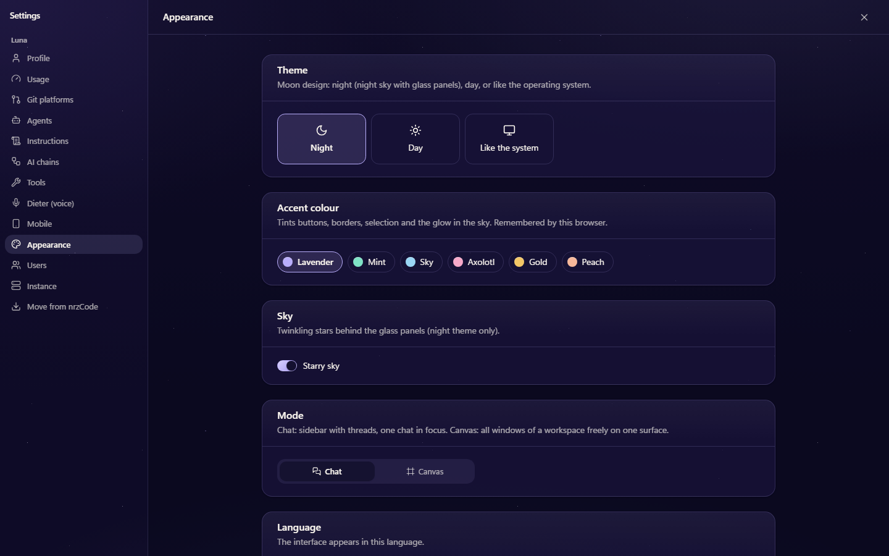

<div align="center">



# luCode

**Every coding agent in one calm chat – under the night sky.**

[Deutsch](docs/README.de.md) · [English](README.md) · [Releases](https://github.com/Luna-OS/Lu-Code/releases)



</div>

luCode runs the command line coding agents – **Claude Code, Codex, Gemini CLI, OpenCode, Kilo Code
and Grok CLI** – and turns their output into one quiet chat: answers in Markdown, work steps
collapsed into single lines, edits as coloured diffs. Projects come from **GitHub** (self-hosted
platforms can be added); every agent gets the platform as an MCP server, so it can push, open pull
requests and releases on its own. It runs as a native app on Windows and macOS and as a server (Docker).

luCode is the [LunaOS](https://github.com/Luna-OS) edition of
[nrzCode](https://github.com/nicorenezweers) – same engine, kept compatible, in the **Moon design**
of luGit, Luma and MoonDisk, with a one-click move from nrzCode and a handful of things on top.

## What luCode adds

| | |
|---|---|
| **Moon design** | Night sky with twinkling stars, glass panels, lavender accent – or the day theme, or like the system. Six accent colours (lavender, mint, sky, axolotl, gold, peach) tint buttons, borders, selection and the glow in the sky. Frosted window glass stays available as an option |
| **Move from nrzCode** | *Settings → Move from nrzCode* finds your nrzCode and brings **everything** over: agent accounts with their sign-ins, git connections, projects with checkouts, uncommitted work and the subagents' worktrees, chats with history, attachments, usage, bots, skills, notes, canvas boards, AI chains, tools and speech models. Claude Code's sessions move too, so chats continue seamlessly. nrzCode stays untouched; repeat the move any time – only new things are added |
| **Live** | Watch every working agent at once: one tile per agent and subagent with its **text** (the answers as they stream in) and its **CLI** (commands with their output, files read and edited, searches, tools – like a terminal). Both, text only or CLI only; the counter in the top bar shows how many are working. Subagent cards and the lineage panel say what each one is doing right now |
| **Updates by themselves** | The desktop apps download a new version in the background, verify its checksum and install it in a quiet moment – no agent working, nobody typing – or when you quit, or at the next start. The page you had open is back afterwards. *Settings → App* turns it off |
| **Search everything** | `Ctrl+K` / `⌘K` opens the command palette: chats, projects, commands – and a full-text search through the messages of all chats |
| **Your instructions** | *Settings → Instructions*: what every agent should know on every run (language, style, tools, taboos) – plus instructions per project on the project page. They are part of the system hint for Claude Code, Codex, Gemini … alike |
| **Export** | Right-click a chat → *Export as Markdown* |
| **Backups** | A consistent snapshot of the database every day (the last seven are kept), or on demand under *Settings → Instance* – download included |
| **Side by side** | Own data folder (`%APPDATA%\luCode`), own ports (8510/8511, the app 18510/18511) and own branch prefix (`lu/…`): luCode and nrzCode run next to each other. Teams work across both – the shared state lives in the same git ref |


<p><b>Live – every agent at a glance.</b> One tile per working agent and subagent: what it says on top, what it runs below – commands with their output, the files it reads and edits.</p>

<table>
<tr>
<td width="50%" valign="top">

<p><b><code>Ctrl+K</code> – find anything.</b> Chats and projects appear as you type, commands sit right below, and the messages of every chat are searched in full.</p>
</td>
<td width="50%" valign="top">

<p><b>Make it yours.</b> Night or day, six accent colours, stars on or off – and frosted window glass if you like to see your desktop through it.</p>
</td>
</tr>
</table>

## Everything from nrzCode

| | |
|---|---|
| **Agents** | Claude Code, Codex, Gemini CLI, OpenCode, Kilo Code and Grok CLI – installed and updated from the app, output unified into messages, work steps, diffs and costs |
| **Several subscriptions** | Any number of accounts per agent, each with its own home directory – two Claude subscriptions never share a login. Pick the account per thread |
| **AI chains and rate limits** | When an account hits its limit, the thread continues automatically once it resets – or right away with the next account of an AI chain (e.g. Claude 1 → Claude 2 → Codex), history included |
| **Subagents** | An agent (or you, with `/subagents`) starts several agents in parallel, each in its own worktree, and waits for them – with a lineage panel and timers |
| **`/status` and `/btw`** | Status with an estimated time left as a popup, or side questions in a side chat – both answered by a small model from the transcript, without interrupting the agent |
| **Composer** | `@` files, `@@` other repositories, `$` skills, `/` commands, images by paste or drag & drop, dictation, agent · account · model · effort picker, queue or interject while the agent works |
| **Git platforms** | GitHub out of the box; the self-hosted luGit and nrzGit appear once they are connected (for instance after the move from nrzCode) or when the administrator offers them. Side by side: projects from your repositories, worktree per thread, branch switcher, commit / push / pull request, changes with diffs, file tree, editor, terminal |
| **Native CLI** | `</>` swaps the chat for the agent's own CLI – same worktree, account, model and session; switching back is instant |
| **Team** | Several people, each with their own luCode or nrzCode, work on the same repository: see what the others' agents are doing, and let the agents message, ask and coordinate with each other – through the repository itself, no extra server |
| **Canvas** | All windows of a workspace – chats, terminals, browsers – on one infinite board with notes, arrows and freehand drawing; agents can read and draw on it |
| **Bots** | Persistent AI teammates with their own memory, working folder and routines |
| **Voice** | Dieter listens (Whisper, locally), talks to the windows of the grid and reads answers aloud |
| **Preview** | Servers the agents start appear in a preview panel (own port with WebSocket support) |
| **Usage** | A ring at the top shows the most used limit; *Settings → Usage* lists Claude and Codex limits, runs, tokens and costs per account |

## Get luCode

| | |
|---|---|
| **Windows** (x64) | `luCode-<version>-Setup.exe` from the [releases](https://github.com/Luna-OS/Lu-Code/releases) – installer per user, no administrator rights (Start menu, uninstall under *Apps*); or `luCode-<version>-x64.zip` – unpack, start `luCode.exe` (one file). SmartScreen may ask once (*More info* → *Run anyway*) |
| **macOS** (Apple Silicon) | `scripts/macos.sh` builds `dist-macos/luCode.app` and a `.dmg` |
| **Server** | Docker (below) |

Every installation starts as a **fresh instance**: no accounts, no projects, no git connections and
no server addresses are built in – you connect your own GitHub (or move over from nrzCode, below).
A fresh instance shows GitHub only; self-hosted git platforms appear once they are connected or
switched on under *Settings → Instance*.

The desktop apps sign you in automatically, update themselves from the GitHub releases – downloaded
in the background, checksum verified, installed when nothing is running – and can be locked with a
6-digit code (*Settings → App*). Data lives in `%APPDATA%\luCode` (Windows) or
`~/Library/Application Support/luCode` (macOS).

### Moving from nrzCode

1. Start luCode. If an nrzCode is found on this machine, the home page offers **Move now** –
   otherwise open *Settings → Move from nrzCode* and enter its data folder (the one with
   `nrzcode.db`; Windows: `%APPDATA%\nrzCode`, macOS: `~/Library/Application Support/nrzCode`,
   Docker: the mounted `/data`).
2. Choose what comes along and click **Move everything**. Build output (`node_modules`, Cargo's
   `target` …) is skipped by default – the next build recreates it.
3. Done: projects, chats and accounts are there, agents stay signed in. Whatever was still running
   in nrzCode arrives as stopped. Later, **Fetch what is new** brings over what was added in
   nrzCode since.

What does not move: the pairing with the phone app (two programs must not present themselves as the
same PC) and what the nrzCode window keeps in the browser (drafts, panel sizes).

### Server with Docker

```bash
docker build -t lucode .
docker run -d --name lucode -p 8510:8510 -p 8511:8511 -v lucode-data:/data \
  -v /var/run/docker.sock:/var/run/docker.sock lucode
```

Open http://localhost:8510 – the first account becomes the administrator. Then:

1. **Settings → Git platforms**: connect GitHub (a personal access token: classic with `repo` and
   `read:org`, or fine-grained with Contents, Pull requests and Administration). Agents get it as
   the MCP server `github`. For a self-hosted luGit (address and a token with the scopes `user`
   and `repo`) or nrzGit (address and a token from nrzGit → Settings → MCP), switch on *Settings →
   Instance → Offer more git platforms* first – then both can be connected next to GitHub.
2. **Settings → Tools**: install the agents you want.
3. **Settings → Agents**: add accounts and sign in (terminal in the app) or paste an API key.
4. Add a project and start a thread.

Agents run unattended (no permission prompts) with the rights of luCode. Give luCode only to people
you would give a shell on that machine.

## Configuration

| Variable | Default | Meaning |
|---|---|---|
| `LUCODE_PORT` | `8510` | HTTP port |
| `LUCODE_PREVIEW_PORT` | `8511` | Preview proxy, `0` turns it off |
| `LUCODE_DATA_DIR` | `./data` (`/data` in Docker) | Database, agent homes, workspaces, installed tools, backups |
| `LUCODE_PRIVATE_FORGES` | `false` | Offer the self-hosted platforms (luGit, nrzGit) to everyone. Otherwise a fresh instance shows GitHub only and they appear once connected; administrators can switch it under *Settings → Instance* |
| `LUCODE_NRZGIT_URL` | – | Default nrzGit address for new users (also makes nrzGit appear) |
| `LUCODE_MAX_PARALLEL_RUNS` | `8` | Agents running at the same time |
| `LUCODE_BIN_<AGENT>` | – | Path to an agent program, e.g. `LUCODE_BIN_CLAUDE` |
| `LUCODE_COOKIE_SECURE` | `false` | Cookies only over HTTPS |
| `LUCODE_IMPORT_DIR` | – | Where to look for an nrzCode data folder first |
| `LUCODE_UPDATE_REPO` | GitHub `Luna-OS/Lu-Code` | API address of the repository the apps update from (GitHub, luGit or nrzGit) |

## Development

```bash
scripts/ui.sh            # web interface (Dioxus 0.7, wasm32-unknown-unknown)
cargo run                # server on http://localhost:8510
cargo test
scripts/windows.sh       # dist-windows/*-Setup.exe, *.zip + .exe (mingw-w64, makensis; also runs in Git Bash on Windows)
scripts/macos.sh         # dist-macos/luCode.app + .dmg
scripts/check-clean.sh   # nothing of one particular instance in source or built files?
scripts/release.sh all   # publish v<version> to GitHub, luGit and/or nrzGit (DRY_RUN=1 to try)
```

Releases can live on GitHub and on private git platforms alike. `scripts/release.sh` takes addresses
and tokens from the environment only (luCode hands them to its agents for the connected platforms)
and refuses to publish when `scripts/check-clean.sh` finds an address of a private network or a
token in the source or in the built programs. Apps that should update from a private platform get
its address through `LUCODE_UPDATE_REPO`.

Architecture and contracts: [ARCHITECTURE.md](ARCHITECTURE.md) · API: [agents](docs/api-agents.md),
[workspace](docs/api-workspace.md), [canvas](docs/api-canvas.md), [team](docs/api-team.md),
[luCode extras and the move](docs/api-lucode.md).

The database schema of nrzCode (migrations `0001`–`0019`) is kept byte for byte; luCode's own
migrations start at `1001`. The move relies on that, and it keeps changes from nrzCode easy to take
over. What luCode adds on the server lives in its own modules (`src/import`, `src/extras`).

## License

AGPL-3.0-or-later, like nrzCode, which luCode is based on – thanks to its author for building it
in the open. luCode is a modified version of nrzCode 1.0.36 (changes by LunaOS since November 2026:
name and identifiers, the Moon design, the move from nrzCode, search, instructions, export, backups,
the live view, updates that install themselves, release tooling). The source of this modified version is this repository; every release carries
the source of exactly that version under its tag. UI components adapted from
[rust-ui](https://github.com/rust-ui/ui) (MIT), fonts: see `static/fonts/LICENSE`.
