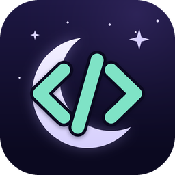
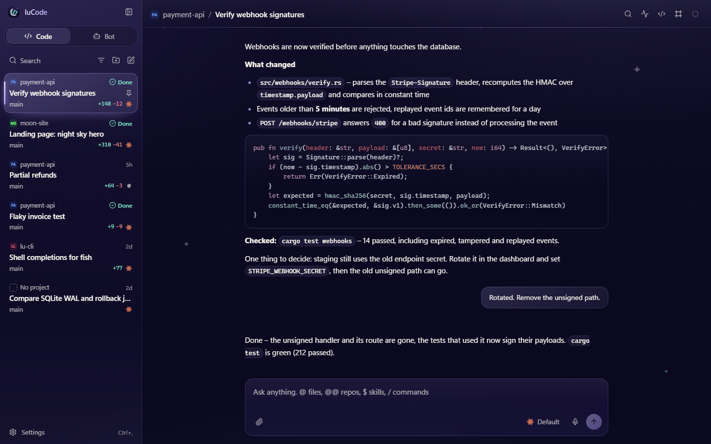
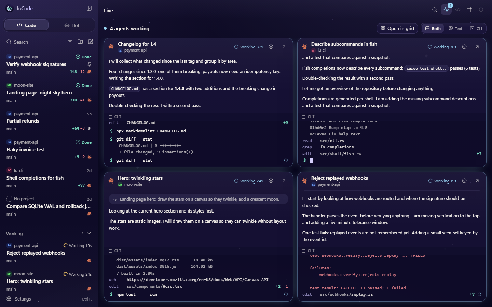
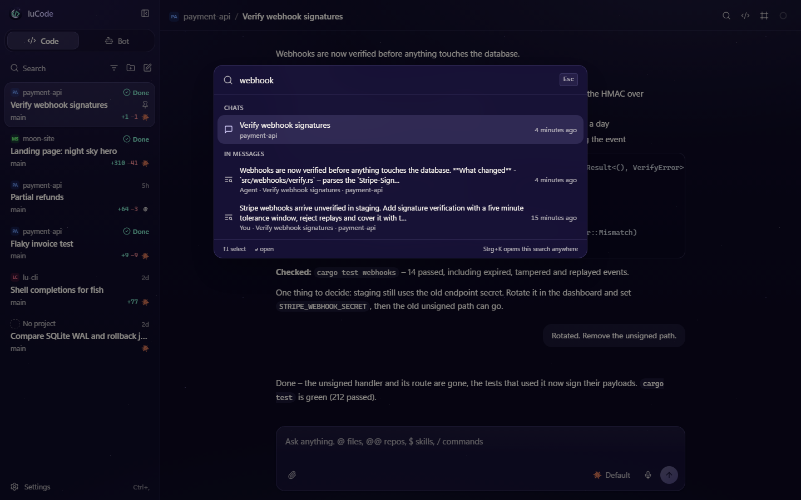
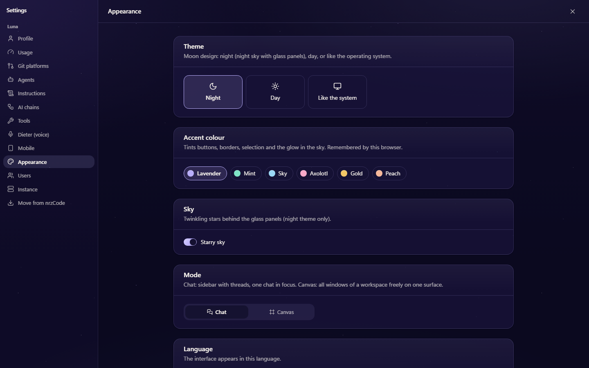

<div align="center">



# luCode

**Alle Coding-Agenten in einem ruhigen Chat – unter dem Nachthimmel.**

[Deutsch](README.de.md) · [English](../README.md) · [Releases](https://github.com/Luna-OS/Lu-Code/releases)



</div>

luCode startet die Kommandozeilen-Agenten **Claude Code, Codex, Gemini CLI, OpenCode, Kilo Code und
Grok CLI** und macht aus ihrer Ausgabe einen ruhigen Chat: Antworten in Markdown, Arbeitsschritte
in einer Zeile, Änderungen als farbige Diffs. Projekte kommen von **GitHub** (selbst gehostete
Plattformen lassen sich dazunehmen); jeder Agent bekommt die Plattform als MCP-Server und kann
selbst pushen, Pull Requests und Releases anlegen. luCode läuft als native App unter Windows und macOS und als Server (Docker).

luCode ist die [LunaOS](https://github.com/Luna-OS)-Ausgabe von
[nrzCode](https://github.com/nicorenezweers) – derselbe Unterbau, kompatibel gehalten, im
**Moon-Design** von luGit, Luma und MoonDisk, mit Umzug aus nrzCode auf einen Klick und einigem
obendrauf.

## Was luCode dazubringt

| | |
|---|---|
| **Moon-Design** | Nachthimmel mit funkelnden Sternen, Glas-Flächen, Lavendel-Akzent – oder das Thema Tag, oder wie das System. Sechs Akzentfarben (Lavendel, Mint, Himmel, Axolotl, Gold, Pfirsich) färben Knöpfe, Ränder, Auswahl und den Schein am Himmel. Das Milchglas-Fenster bleibt als Option |
| **Umzug von nrzCode** | *Einstellungen → Umzug von nrzCode* findet dein nrzCode und holt **alles** herüber: Agent-Konten samt Anmeldung, Git-Verbindungen, Projekte mit Checkouts, Uneingechecktem und den Worktrees der Subagenten, Chats mit Verlauf, Anhänge, Nutzung, Bots, Skills, Notizen, Canvas, KI-Ketten, Werkzeuge und Sprachmodelle. Die Sitzungen von Claude Code ziehen mit – Chats gehen nahtlos weiter. nrzCode bleibt unberührt; der Umzug lässt sich jederzeit wiederholen, dann kommt nur Neues dazu |
| **Live** | Allen arbeitenden Agenten zugleich zusehen: je Agent und Subagent eine Kachel mit seinem **Text** (die Antworten, während sie entstehen) und seinem **CLI** (Befehle mit Ausgabe, gelesene und bearbeitete Dateien, Suchen, Werkzeuge – wie in einem Terminal). Beides, nur Text oder nur CLI; der Zähler oben zeigt, wie viele gerade arbeiten. Die Karten der Subagenten und der Stammbaum sagen, was jeder gerade tut |
| **Updates von selbst** | Die Desktop-Apps laden eine neue Version im Hintergrund, prüfen ihre Prüfsumme und installieren sie in einem ruhigen Moment – kein Agent arbeitet, niemand tippt – oder beim Beenden bzw. beim nächsten Start. Danach steht dieselbe Seite wieder da. Abschaltbar unter *Einstellungen → App* |
| **Alles durchsuchen** | `Strg+K` / `⌘K` öffnet die Befehlspalette: Chats, Projekte, Befehle – und eine Volltextsuche durch die Nachrichten aller Chats |
| **Eigene Anweisungen** | *Einstellungen → Anweisungen*: was jeder Agent bei jedem Lauf wissen soll (Sprache, Stil, Werkzeuge, Tabus) – dazu Anweisungen je Projekt auf der Projektseite. Sie stehen im Systemhinweis, für Claude Code, Codex, Gemini … gleichermassen |
| **Export** | Rechtsklick auf einen Chat → *Als Markdown exportieren* |
| **Sicherungen** | Täglich ein in sich stimmiges Abbild der Datenbank (die letzten sieben bleiben) oder auf Knopfdruck unter *Einstellungen → Instanz* – samt Herunterladen |
| **Nebeneinander** | Eigener Datenordner (`%APPDATA%\luCode`), eigene Ports (8510/8511, die App 18510/18511) und eigener Branch-Präfix (`lu/…`): luCode und nrzCode laufen nebeneinander. Teams arbeiten über beide hinweg – der gemeinsame Stand liegt in derselben Git-Referenz |


<p><b>Live – alle Agenten auf einen Blick.</b> Je arbeitendem Agenten und Subagenten eine Kachel: oben, was er sagt, unten, was er ausführt – Befehle mit ihrer Ausgabe, die Dateien, die er liest und bearbeitet.</p>

<table>
<tr>
<td width="50%" valign="top">

<p><b><code>Strg+K</code> – alles finden.</b> Chats und Projekte erscheinen beim Tippen, Befehle stehen gleich darunter, und die Nachrichten aller Chats werden im Volltext durchsucht.</p>
</td>
<td width="50%" valign="top">

<p><b>Mach es zu deinem.</b> Nacht oder Tag, sechs Akzentfarben, Sterne an oder aus – und Milchglas, wenn der Schreibtisch durchscheinen soll.</p>
</td>
</tr>
</table>

## Alles aus nrzCode

| | |
|---|---|
| **Agenten** | Claude Code, Codex, Gemini CLI, OpenCode, Kilo Code und Grok CLI – aus der App installiert und aktualisiert, die Ausgabe vereinheitlicht zu Nachrichten, Arbeitsschritten, Diffs und Kosten |
| **Mehrere Abos** | Beliebig viele Konten je Agent, jedes mit eigenem Home – zwei Claude-Abos teilen nie eine Anmeldung. Das Konto wählst du je Thread |
| **KI-Ketten und Rate-Limits** | Ist ein Konto am Limit, macht der Thread nach dem Zurücksetzen von selbst weiter – oder sofort mit dem nächsten Konto einer KI-Kette (z. B. Claude 1 → Claude 2 → Codex), samt Verlauf |
| **Subagenten** | Ein Agent (oder du, mit `/subagents`) startet mehrere Agenten parallel, jeden im eigenen Worktree, und wartet auf sie – mit Stammbaum und Zeiten |
| **`/status` und `/btw`** | Stand mit geschätzter Restdauer als Popup, oder Zwischenfragen im Seiten-Chat – beides beantwortet ein kleines Modell aus dem Verlauf, ohne den Agenten zu unterbrechen |
| **Eingabe** | `@` Dateien, `@@` andere Repositories, `$` Skills, `/` Befehle, Bilder per Einfügen oder Ziehen, Diktat, Wahl von Agent · Konto · Modell · Denk-Stufe, Einreihen oder Dazwischenrufen, während der Agent arbeitet |
| **Git-Plattformen** | GitHub ab Werk; die selbst gehosteten luGit und nrzGit erscheinen, sobald sie verbunden sind (etwa nach dem Umzug von nrzCode) oder die Verwaltung sie anbietet. Nebeneinander: Projekte aus deinen Repositories, Worktree je Thread, Branch-Wechsel, Commit / Push / Pull Request, Änderungen mit Diffs, Dateibaum, Editor, Terminal |
| **Natives CLI** | `</>` tauscht den Chat gegen das eigene CLI des Agenten – gleicher Worktree, gleiches Konto, Modell und dieselbe Sitzung; zurück geht es sofort |
| **Team** | Mehrere Leute, jeder mit eigenem luCode oder nrzCode, arbeiten am selben Repository: sehen, woran die Agenten der anderen sitzen, und lassen die Agenten einander schreiben, fragen und sich abstimmen – über das Repository selbst, ohne weiteren Server |
| **Canvas** | Alle Fenster eines Arbeitsbereichs – Chats, Terminals, Browser – auf einer unendlichen Fläche mit Notizen, Pfeilen und Freihand; Agenten können sie lesen und darauf zeichnen |
| **Bots** | Dauerhafte KI-Teamkollegen mit eigenem Gedächtnis, Arbeitsordner und Routinen |
| **Sprache** | Dieter hört zu (Whisper, lokal), spricht mit den Fenstern des Rasters und liest Antworten vor |
| **Vorschau** | Server, die Agenten starten, erscheinen in einem Vorschau-Paneel (eigener Port mit WebSocket) |
| **Nutzung** | Ein Ring oben zeigt das am stärksten genutzte Limit; *Einstellungen → Nutzung* listet Limits von Claude und Codex, Läufe, Tokens und Kosten je Konto |

## luCode bekommen

| | |
|---|---|
| **Windows** (x64) | `luCode-<version>-Setup.exe` aus den [Releases](https://github.com/Luna-OS/Lu-Code/releases) – Installer je Benutzer, ohne Administratorrechte (Startmenü, Deinstallieren unter *Apps*); oder `luCode-<version>-x64.zip` – entpacken, `luCode.exe` starten (eine Datei). SmartScreen fragt evtl. einmal (*Weitere Informationen* → *Trotzdem ausführen*) |
| **macOS** (Apple Silicon) | `scripts/macos.sh` baut `dist-macos/luCode.app` und eine `.dmg` |
| **Server** | Docker (unten) |

Jede Installation beginnt als **frische Instanz**: Es sind keine Konten, keine Projekte, keine
Git-Verbindungen und keine Server-Adressen eingebaut – du verbindest dein eigenes GitHub (oder
ziehst von nrzCode um, siehe unten). Eine frische Instanz zeigt nur GitHub; selbst gehostete
Git-Plattformen erscheinen, sobald sie verbunden sind oder unter *Einstellungen → Instanz*
eingeschaltet werden.

Die Desktop-Apps melden dich von selbst an, aktualisieren sich aus den GitHub-Releases – im
Hintergrund geladen, Prüfsumme geprüft, installiert, wenn gerade nichts läuft – und lassen sich mit
einem 6-stelligen Code sperren (*Einstellungen → App*). Die Daten liegen in `%APPDATA%\luCode`
(Windows) bzw. `~/Library/Application Support/luCode` (macOS).

### Umzug von nrzCode

1. luCode starten. Findet es ein nrzCode auf diesem Rechner, bietet die Startseite **Jetzt
   umziehen** an – sonst *Einstellungen → Umzug von nrzCode* öffnen und den Datenordner eintragen
   (der mit der `nrzcode.db`; Windows: `%APPDATA%\nrzCode`, macOS:
   `~/Library/Application Support/nrzCode`, Docker: das eingehängte `/data`).
2. Wählen, was mitkommt, und **Alles übernehmen** klicken. Build-Ordner (`node_modules`, `target`
   von Cargo …) bleiben ab Werk in nrzCode – der nächste Build legt sie neu an.
3. Fertig: Projekte, Chats und Konten sind da, die Agenten bleiben angemeldet. Was in nrzCode noch
   lief, kommt als angehalten an. Später holt **Neues nachholen**, was in nrzCode dazugekommen ist.

Was nicht umzieht: die Kopplung mit der Handy-App (zwei Programme dürfen sich nicht als derselbe PC
melden) und was das Fenster von nrzCode im Browser behält (Entwürfe, Spaltenbreiten).

### Server mit Docker

```bash
docker build -t lucode .
docker run -d --name lucode -p 8510:8510 -p 8511:8511 -v lucode-data:/data \
  -v /var/run/docker.sock:/var/run/docker.sock lucode
```

http://localhost:8510 öffnen – das erste Konto wird Administrator. Dann:

1. **Einstellungen → Git-Plattformen**: GitHub verbinden (ein Personal Access Token: klassisch mit
   `repo` und `read:org`, oder fein abgestuft mit Contents, Pull requests und Administration). Die
   Agenten bekommen es als MCP-Server `github`. Für ein selbst gehostetes luGit (Adresse und ein
   Token mit den Rechten `user` und `repo`) oder nrzGit (Adresse und ein Token aus nrzGit →
   Einstellungen → MCP) zuerst *Einstellungen → Instanz → Weitere Git-Plattformen anbieten*
   einschalten – dann lassen sich beide neben GitHub verbinden.
2. **Einstellungen → Werkzeuge**: die gewünschten Agenten installieren.
3. **Einstellungen → Agenten**: Konten anlegen und anmelden (Terminal in der App) oder einen
   API-Schlüssel einfügen.
4. Ein Projekt hinzufügen und einen Thread beginnen.

Agenten laufen unbeaufsichtigt (ohne Rückfragen zu Rechten) mit den Rechten von luCode. Gib luCode
nur Leuten, denen du auf dem Rechner auch eine Shell geben würdest.

## Konfiguration

| Variable | Vorgabe | Bedeutung |
|---|---|---|
| `LUCODE_PORT` | `8510` | HTTP-Port |
| `LUCODE_PREVIEW_PORT` | `8511` | Vorschau-Proxy, `0` schaltet ihn ab |
| `LUCODE_DATA_DIR` | `./data` (`/data` in Docker) | Datenbank, Homes der Agenten, Arbeitsbereiche, installierte Werkzeuge, Sicherungen |
| `LUCODE_PRIVATE_FORGES` | `false` | Die selbst gehosteten Plattformen (luGit, nrzGit) jedem anbieten. Sonst zeigt eine frische Instanz nur GitHub und sie erscheinen, sobald sie verbunden sind; die Verwaltung stellt es unter *Einstellungen → Instanz* um |
| `LUCODE_NRZGIT_URL` | – | Vorgabe-Adresse von nrzGit für neue Benutzer (damit erscheint auch nrzGit) |
| `LUCODE_MAX_PARALLEL_RUNS` | `8` | Agenten, die gleichzeitig laufen |
| `LUCODE_BIN_<AGENT>` | – | Pfad zu einem Agent-Programm, z. B. `LUCODE_BIN_CLAUDE` |
| `LUCODE_COOKIE_SECURE` | `false` | Cookies nur über HTTPS |
| `LUCODE_IMPORT_DIR` | – | Wo zuerst nach einem Datenordner von nrzCode gesucht wird |
| `LUCODE_UPDATE_REPO` | GitHub `Luna-OS/Lu-Code` | API-Adresse des Repositorys, aus dem sich die Apps aktualisieren (GitHub, luGit oder nrzGit) |

## Entwicklung

```bash
scripts/ui.sh            # Oberfläche (Dioxus 0.7, wasm32-unknown-unknown)
cargo run                # Server auf http://localhost:8510
cargo test
scripts/windows.sh       # dist-windows/*-Setup.exe, *.zip + .exe (mingw-w64, makensis; läuft auch in Git Bash unter Windows)
scripts/macos.sh         # dist-macos/luCode.app + .dmg
scripts/check-clean.sh   # steht nichts von einer bestimmten Instanz im Quelltext oder in den Programmen?
scripts/release.sh all   # v<version> nach GitHub, luGit und/oder nrzGit (DRY_RUN=1 zum Probieren)
```

Releases können auf GitHub liegen und genauso in privaten Git-Plattformen. `scripts/release.sh`
nimmt Adressen und Tokens nur aus der Umgebung (luCode gibt sie seinen Agenten für die verbundenen
Plattformen mit) und veröffentlicht nicht, wenn `scripts/check-clean.sh` im Quelltext oder in den
gebauten Programmen die Adresse eines privaten Netzes oder ein Token findet. Apps, die ihre Updates
aus einer privaten Plattform holen sollen, bekommen deren Adresse über `LUCODE_UPDATE_REPO`.

Aufbau und Verträge: [ARCHITECTURE.md](../ARCHITECTURE.md) · API: [agents](api-agents.md),
[workspace](api-workspace.md), [canvas](api-canvas.md), [team](api-team.md),
[luCode-Extras und der Umzug](api-lucode.md).

Das Datenbank-Schema von nrzCode (Migrationen `0001`–`0019`) bleibt Byte für Byte erhalten; die
eigenen Migrationen von luCode beginnen bei `1001`. Darauf baut der Umzug, und so lassen sich
Änderungen aus nrzCode leicht übernehmen. Was luCode auf dem Server dazubringt, liegt in eigenen
Modulen (`src/import`, `src/extras`).

## Lizenz

AGPL-3.0-or-later, wie nrzCode, auf dem luCode aufbaut – danke an seinen Autor, dass es offen
entsteht. luCode ist eine geänderte Fassung von nrzCode 1.0.36 (Änderungen von LunaOS seit November
2026: Name und Bezeichner, das Moon-Design, der Umzug von nrzCode, Suche, Anweisungen, Export,
Sicherungen, die Live-Ansicht, Updates von selbst, Werkzeuge fürs Veröffentlichen). Der Quelltext dieser geänderten Fassung ist dieses
Repository; zu jedem Release gehört der Quelltext genau dieser Version unter seinem Tag. Bausteine der Oberfläche
nach [rust-ui](https://github.com/rust-ui/ui) (MIT), Schriften: siehe `static/fonts/LICENSE`.
